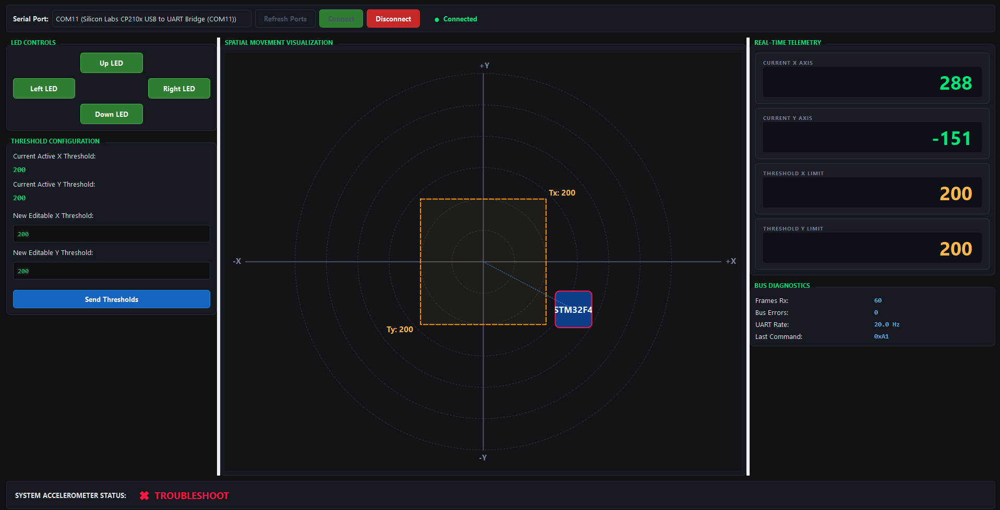
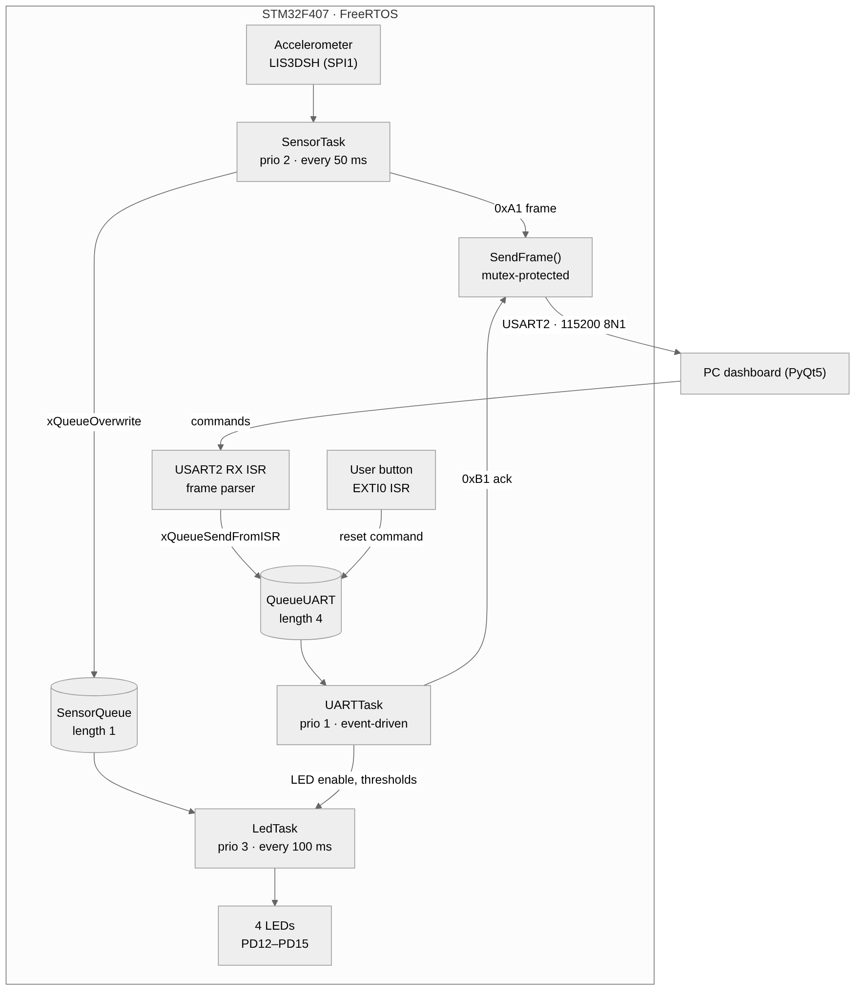

# FreeRTOS Accelero Project

Tilt monitor for the STM32F407 Discovery board. FreeRTOS tasks read the on-board accelerometer, show the tilt direction on the four LEDs and stream the measurements over UART to a PC dashboard, which can also control the board.

This is the FreeRTOS version of an earlier bare-metal project: acquisition, LED control and communication now run as independent tasks, each with its own priority and period.



## Features

- Accelerometer sampled at 20 Hz (X and Y in mg)
- Tilt shown on the four LEDs: each enabled LED stays on, and blinks at 5 Hz when the board tilts past the threshold in its direction
- 8-byte binary protocol over UART, in both directions
- PC dashboard (Python, PyQt5): live X/Y view, threshold settings, LED enable/disable, link diagnostics
- User button: resets the thresholds to their default value (200 mg)

## Hardware

- STM32F4DISCOVERY / STM32F407G-DISC1 board. The ST BSP handles both accelerometer versions (LIS3DSH, or LIS302DL on older boards).
- A 3.3 V USB-to-UART adapter: adapter RX to PA2, adapter TX to PA3, GND to GND. Link settings: 115200 baud, 8N1, no flow control.

| Pin | Function |
|---|---|
| PA0 | User button (EXTI0): reset the thresholds |
| PA2 / PA3 | USART2 TX / RX |
| PA5 / PA6 / PA7, PE3 | SPI1 SCK / MISO / MOSI, accelerometer chip select |
| PD12 (green) | Tilt left: X < -threshold |
| PD13 (orange) | Tilt up: Y > threshold |
| PD14 (red) | Tilt right: X > threshold |
| PD15 (blue) | Tilt down: Y < -threshold |

## Software architecture



| Task | Priority | Period | Stack | Role |
|---|---|---|---|---|
| `LedTask` | 3 (highest) | 100 ms | 128 words | Reads the latest sample and drives the LEDs |
| `SensorTask` | 2 | 50 ms | 256 words | Reads the accelerometer, publishes the sample and sends it to the PC |
| `UARTTask` | 1 | on event | 256 words | Executes the commands received from the PC or the button |

The two interrupts keep their work short: the USART2 interrupt rebuilds the incoming frame byte by byte, the EXTI0 interrupt detects the button press, and both post a command to `QueueUART`. Their NVIC priority (6) is numerically above `configLIBRARY_MAX_SYSCALL_INTERRUPT_PRIORITY` (5), as FreeRTOS requires for interrupts that call `FromISR` functions.

Design choices:

- **Latest-value queue**: `SensorQueue` has a length of 1 and is written with `xQueueOverwrite()`, so the LED task always uses the most recent sample instead of a backlog.
- **Shared UART**: `SensorTask` and `UARTTask` both transmit, so a mutex (with priority inheritance) serializes `SendFrame()`.
- **Exact periods** with `vTaskDelayUntil()`.
- **Shared SysTick**: the same interrupt drives the HAL time base (`HAL_IncTick()`, timeouts) and the FreeRTOS tick.
- **Error handling**: UART reception restarts after an overrun (`HAL_UART_ErrorCallback()`), stack overflows are detected (`configCHECK_FOR_STACK_OVERFLOW = 2`), and fatal errors go through a central handler (`src/global_err`).
- **Watchdog** (Release build): the independent watchdog is refreshed by the idle task, so a task that hogs the CPU makes the board reset.

## UART protocol

Every frame is 8 bytes, little-endian:

| Byte | 0 | 1 | 2–3 | 4–7 |
|---|---|---|---|---|
| Field | SOF = `0xAA` | CMD | CONFIG (`0x0000`) | DATA (`uint32`) |

| CMD | Direction | DATA | Meaning |
|---|---|---|---|
| `0xA1` | board → PC | bits 31–16: X, bits 15–0: Y (`int16`, mg) | Accelerometer sample, every 50 ms |
| `0xB1` | board → PC | 0 | Thresholds back to 200 mg (at startup, after a button press, or to acknowledge a reset) |
| `0xB1` | PC → board | – | Reset the thresholds |
| `0xFF` | PC → board | bits 15–0: X threshold, bits 31–16: Y threshold (`uint16`, mg) | Set the thresholds |
| `0xC1` `0xD1` `0xE1` `0xF1` | PC → board | bit 0: 1 = on, 0 = off | Enable the left / right / up / down LED |

X is in the high half-word of an `0xA1` frame but in the low half-word of an `0xFF` frame.

Example: X = -10 mg and Y = 12 mg give the frame `AA A1 00 00 0C 00 F6 FF`.

## Project layout

```
src/
├── Apk/          application: tasks and protocol
├── BSP/          board support: peripheral init, accelerometer, LEDs, watchdog
├── Main/         main(), interrupt handlers, HAL MSP, startup code
├── global_err/   central error handler
├── util/         log macros
└── Middleware/   FreeRTOS 10.3.1 (ARM_CM4F port, heap_4)
extern/           STM32F4 HAL, CMSIS and STM32F4-Discovery BSP (STMicroelectronics)
test/             PC dashboard
```

## Build and flash

1. In STM32CubeIDE (tested with 2.1.1): **File → Import → General → Existing Projects into Workspace**, then select this folder.
2. Build the **Debug** (`-O0`) or **Release** (`-Os`, watchdog enabled) configuration.
3. Flash with the on-board ST-LINK (**Run** or **Debug**).

The code builds with `-Wall -Wextra -Werror -pedantic` and no warnings. To use `printf` through the debugger (semihosting), see `USE_SEMIHOSTING` in `src/Main/main.c`.

## Dashboard

```bash
pip install pyserial PyQt5
python "test/Python Dashboard.py"
```

Select the adapter's COM port, then click **Connect**.

## License

The project code is released under the [MIT License](LICENSE). FreeRTOS (MIT) and the STMicroelectronics drivers (HAL, CMSIS, BSP) keep their original licenses: see the LICENSE files and source headers in their folders.
